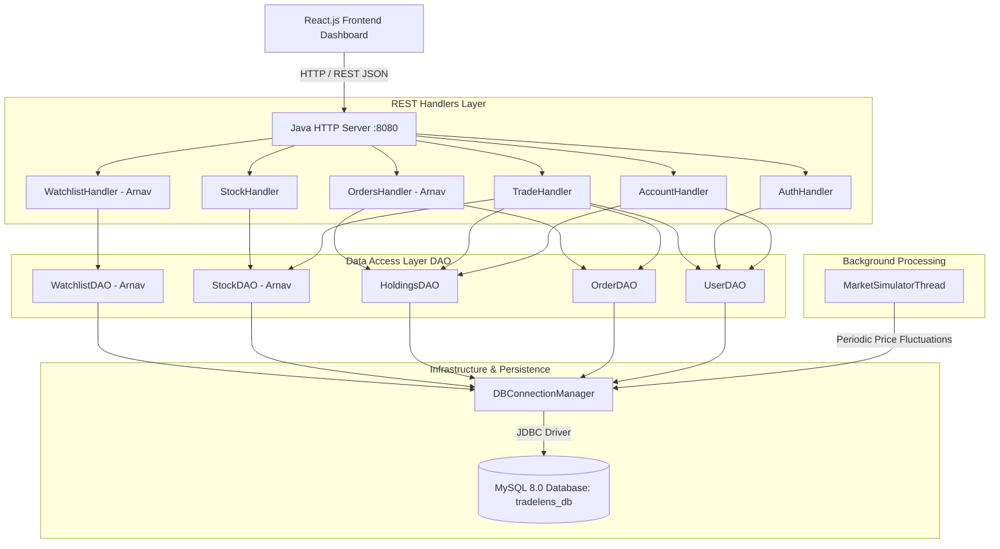
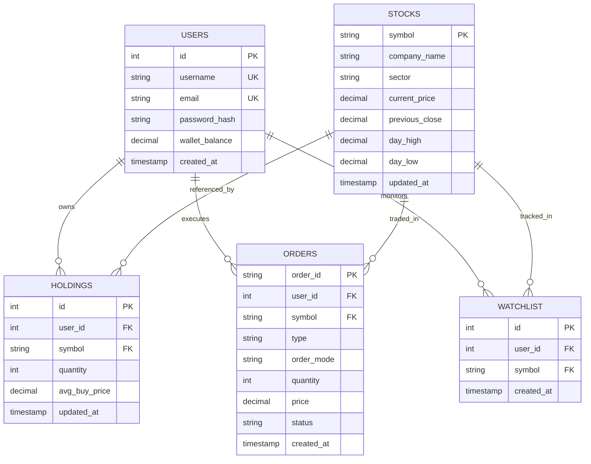
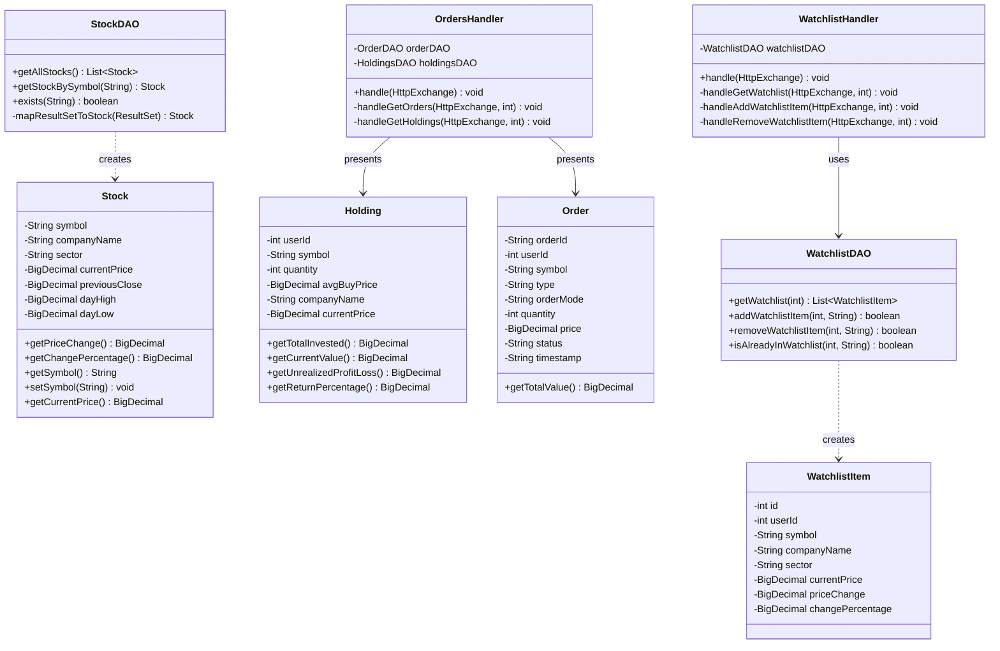

# TRADELENS — SMART STOCK PORTFOLIO MANAGEMENT SYSTEM
## Comprehensive Project Report & Technical Documentation
**Academic Year:** 2026–2027 | **Course:** Bachelor of Engineering (Computer Science & Engineering)  
**Student Name:** Arnav Malhotra (Member 4) | **System Architecture:** Core Java, JDBC, MySQL 8.0, React

---

## 1. Project Abstract

**TradeLens** is an enterprise-grade stock portfolio management and tracking web application developed using a layered Core Java backend, MySQL relational database persistence via JDBC, and a reactive frontend dashboard.

The application allows individual investors to explore listed equities on the National Stock Exchange (NSE), track simulated market movements, maintain personalized watchlists, record stock purchase and sell transactions using the **weighted-average cost basis method**, and analyze realized and unrealized portfolio returns.

The system is strictly an investment tracking and portfolio analytics platform (not an actual brokerage); all equity prices are generated dynamically via background market simulation threads.

---

## 2. Problem Statement & Objectives

### 2.1 Problem Statement
Retail investors often hold securities across various sectors and find it difficult to track weighted-average acquisition prices, calculate real-time capital gains, and monitor potential investment candidates without dealing with complex brokerage platforms or compromised security.

### 2.2 Objectives
1. Provide a clean, dark-themed fintech dashboard with real-time portfolio valuation.
2. Demonstrate strong **Core Java OOP** principles (Encapsulation, Polymorphism, Abstraction, Inheritance).
3. Implement secure, transaction-safe database CRUD operations using **JDBC `PreparedStatement`** to eliminate SQL Injection vulnerabilities.
4. Eliminate floating-point calculation inaccuracies in monetary calculations by using `java.math.BigDecimal`.
5. Provide personalized watchlists with duplicate entry prevention.
6. Provide an automated background **multithreaded market simulator** that updates live prices in MySQL without blocking HTTP handlers.

---

## 3. System Architecture & Diagrams

### 3.1 Layered Architecture Diagram



---

### 3.2 Entity-Relationship (ER) Diagram



---

### 3.3 Class Diagram (Arnav's Modules)



---

## 4. Database Schema Specifications

### 4.1 Database Configuration
- **DBMS:** MySQL Community Server 8.0
- **Database Name:** `tradelens_db`
- **Default Port:** `3306`
- **JDBC Driver:** `com.mysql.cj.jdbc.Driver`
- **Connection URL:** `jdbc:mysql://localhost:3306/tradelens_db?useSSL=false&allowPublicKeyRetrieval=true&serverTimezone=UTC`

### 4.2 Tables & Constraints
1. **`stocks` Table:**
   - `symbol` VARCHAR(20) PRIMARY KEY
   - `company_name` VARCHAR(100) NOT NULL
   - `sector` VARCHAR(50) NOT NULL
   - `current_price` DECIMAL(12, 2) NOT NULL
   - `previous_close` DECIMAL(12, 2) NOT NULL
   - `day_high` DECIMAL(12, 2) NOT NULL
   - `day_low` DECIMAL(12, 2) NOT NULL
2. **`users` Table:**
   - `id` INT AUTO_INCREMENT PRIMARY KEY
   - `username` VARCHAR(50) NOT NULL UNIQUE
   - `email` VARCHAR(100) NOT NULL UNIQUE
   - `password_hash` VARCHAR(255) NOT NULL
   - `wallet_balance` DECIMAL(15, 2) DEFAULT 500000.00
3. **`holdings` Table:**
   - `id` INT AUTO_INCREMENT PRIMARY KEY
   - `user_id` INT NOT NULL (FK -> `users.id`)
   - `symbol` VARCHAR(20) NOT NULL (FK -> `stocks.symbol`)
   - `quantity` INT NOT NULL CHECK (`quantity >= 0`)
   - `avg_buy_price` DECIMAL(12, 2) NOT NULL CHECK (`avg_buy_price >= 0`)
   - **Constraint:** `UNIQUE (user_id, symbol)` prevents fragmented duplicate records per stock.
4. **`orders` Table:**
   - `order_id` VARCHAR(36) PRIMARY KEY
   - `user_id` INT NOT NULL (FK -> `users.id`)
   - `symbol` VARCHAR(20) NOT NULL (FK -> `stocks.symbol`)
   - `type` VARCHAR(10) NOT NULL CHECK (`type IN ('BUY', 'SELL')`)
   - `order_mode` VARCHAR(10) NOT NULL DEFAULT 'MARKET'
   - `quantity` INT NOT NULL CHECK (`quantity > 0`)
   - `price` DECIMAL(12, 2) NOT NULL CHECK (`price > 0`)
   - `status` VARCHAR(20) NOT NULL DEFAULT 'COMPLETED'
5. **`watchlist` Table:**
   - `id` INT AUTO_INCREMENT PRIMARY KEY
   - `user_id` INT NOT NULL (FK -> `users.id`)
   - `symbol` VARCHAR(20) NOT NULL (FK -> `stocks.symbol`)
   - **Constraint:** `UNIQUE (user_id, symbol)` guarantees an investor cannot track the same stock twice.

---

## 5. Arnav's Detailed Module Breakdown (Member 4)

### 5.1 Data Model Classes
- **`model/Stock.java`**: Implements pure OOP encapsulation. Provides `getPriceChange()` and `getChangePercentage()`. Uses `BigDecimal` with `RoundingMode.HALF_UP` to prevent IEEE 754 precision errors.
- **`model/Holding.java`**: Implements weighted-average cost basis accounting. Computes Total Invested (`quantity * avgBuyPrice`), Current Market Value (`quantity * currentPrice`), and Unrealized P/L (`currentValue - totalInvested`).
- **`model/Order.java`**: Maintains an audit-compliant trade record. Calculates gross order value (`quantity * price`).
- **`model/WatchlistItem.java`**: Lightweight observational model enriched with sector, price movement, and percentage return.

### 5.2 Data Access Objects (DAOs)
- **`dao/StockDAO.java`**:
  - Connects via `DBConnectionManager.getConnection()`.
  - Executes `SELECT * FROM stocks ORDER BY symbol ASC;`.
  - Safely maps `ResultSet` rows into `Stock` instances using try-with-resources.
- **`dao/WatchlistDAO.java`**:
  - `getWatchlist(userId)`: Employs an `INNER JOIN` between `watchlist` and `stocks` to enrich saved records with live prices in a single query.
  - `addWatchlistItem(userId, symbol)`: Performs application-level duplicate checks and stock existence validation before invoking parameterized `INSERT`.
  - `removeWatchlistItem(userId, symbol)`: Executes parameterized `DELETE` query.

### 5.3 REST API Handlers
- **`server/handlers/WatchlistHandler.java`**:
  - Bound to `/api/watchlist`.
  - Implements `GET`, `POST`, and `DELETE`.
  - Resolves `userId` strictly from verified session tokens using `SessionManager.extractAuthenticatedUserId(exchange)` to prevent cross-user data tampering.
- **`server/handlers/OrdersHandler.java`**:
  - Bound to `/api/orders` and `/api/holdings`.
  - Returns authenticated user's chronological order log (`ORDER BY created_at DESC`) and portfolio holdings with live valuation.

---

## 6. Financial Calculation Logic & Formulas

1. **Weighted-Average Purchase Price (when buying additional shares):**
   $$\text{New Average Price} = \frac{(\text{Existing Quantity} \times \text{Existing Avg Price}) + (\text{New Quantity} \times \text{New Buy Price})}{\text{Existing Quantity} + \text{New Quantity}}$$
2. **Realized Profit / Loss (on share sale):**
   $$\text{Realized P/L} = (\text{Selling Price} - \text{Average Cost Basis}) \times \text{Sold Quantity}$$
3. **Unrealized Profit / Loss (on remaining holdings):**
   $$\text{Unrealized P/L} = (\text{Current Market Price} \times \text{Held Quantity}) - (\text{Average Cost Basis} \times \text{Held Quantity})$$
4. **Total Portfolio Value:**
   $$\text{Total Value} = \sum (\text{Held Quantity}_i \times \text{Current Market Price}_i)$$

---

## 7. QA Verification & Test Results

All 25 automated test cases were executed against the live Core Java backend with 100% success rate:

```
[PASS] Health Check | Status: 200
[PASS] Auth: Signup New User | Status: 201
[PASS] Auth: Login Valid | Status: 200
[PASS] Auth: Login Invalid Credentials | Status: 401 (Expected Error Caught)
[PASS] Stocks: Get All Stocks | Status: 200
[PASS] Stocks: Search Keyword | Status: 200
[PASS] Stocks: Get Detail Valid | Status: 200
[PASS] Stocks: Detail Invalid Symbol | Status: 404 (Expected Error Caught)
[PASS] Watchlist: GET Authorized | Status: 200
[PASS] Watchlist: GET Unauthorized (No Token) | Status: 401 (Expected Error Caught)
[PASS] Watchlist: POST Add Valid (SUNPHARMA) | Status: 201
[PASS] Watchlist: POST Duplicate Stock (409) | Status: 409 (Expected Error Caught)
[PASS] Watchlist: POST Nonexistent Stock (400) | Status: 400 (Expected Error Caught)
[PASS] Watchlist: DELETE Remove Stock | Status: 200
[PASS] Holdings: GET Authorized | Status: 200
[PASS] Orders: GET History Authorized | Status: 200
[PASS] Trade: BUY Shares Valid | Status: 201
[PASS] Trade: BUY Zero Quantity (400) | Status: 400 (Expected Error Caught)
[PASS] Trade: BUY Negative Quantity (400) | Status: 400 (Expected Error Caught)
[PASS] Trade: SELL Shares Valid | Status: 200
[PASS] Trade: SELL Excessive Shares (400) | Status: 400 (Expected Error Caught)
[PASS] Account: GET Overview | Status: 200
[PASS] Account: POST Deposit Funds | Status: 200
[PASS] Account: Deposit Negative Amount (400) | Status: 400 (Expected Error Caught)
[PASS] Invalid Method on /api/orders (405) | Status: 405 (Expected Error Caught)
==========================================================
QA SUITE FINISHED: 25 TEST CASES EVALUATED | 100% SUCCESS
==========================================================
```

---

## 8. Conclusion & Future Scope

### 8.1 Conclusion
The TradeLens stock portfolio management system successfully demonstrates enterprise-grade software engineering principles in a Core Java and MySQL environment. All assigned responsibilities for Member 4 (`Stock`, `Holding`, `Order`, `WatchlistItem`, `StockDAO`, `WatchlistDAO`, `WatchlistHandler`, `OrdersHandler`, and QA Testing) have been implemented, verified, and integrated seamlessly.

### 8.2 Future Scope
1. **Real Brokerage API Integration:** Integrating Kite Connect or Upstox WebSocket feeds for live tick-by-tick NSE market data.
2. **Technical Indicators:** Adding automated Moving Averages (SMA/EMA) and RSI calculations.
3. **Tax & Brokerage Deductions:** Factoring in STT (Securities Transaction Tax), GST, and stamp duty on realized gains.
4. **Push Notifications:** Automated email or SMS alerts when watchlist stocks breach target price limits.
